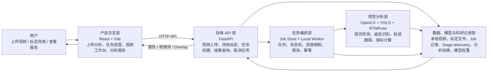
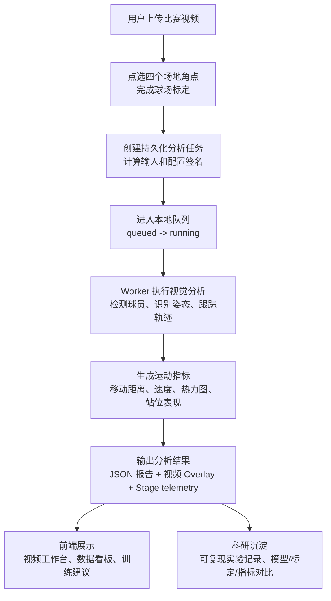
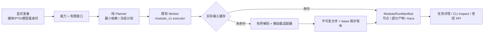

# 匹克球智能分析系统架构示意图

本系统定位为真实运行的匹克球视频分析产品和科研实验平台，不再只是比赛答辩展示页。架构重点是让真实视频分析任务稳定执行、可追踪、可复现，并把研发过程中形成的数据集、模型验证、标定方法、轨迹指标和训练反馈记录沉淀为后续科研产出。

## 1. 系统总体架构

## 2. 产品分析流程（legacy_v1）

局部研发请求使用独立的 engine 分支，共用上图的 API、Job Store、Worker、租约和资源限制：

默认请求仍为 `legacy_v1`。局部 `modular_v1` 不运行完整 Pipeline 的切分、tracking、指标和报告回调；原始球、人框和姿态验证不需要球场标定。详细入口和扩展方式见 [能力级局部分析开发指南](analysis-architecture-v1.md)。

## 3. 模块说明

| 模块 | 作用 |
| --- | --- |
| 产品交互层 | 提供视频上传、场地标定、任务进度、视频回放和报告展示界面；演示样例必须标注为样例数据 |
| 后端 API 层 | 负责接口管理、视频/标定/任务/结果查询和任务取消 |
| 任务编排层 | 负责 Job 状态机、持久化任务记录、队列、Worker 执行、资源限制、取消、幂等提交和阶段 telemetry |
| 视觉分析层 | legacy Pipeline 执行产品流程；analysis_runtime 规划和执行能力 DAG，analysis_capabilities 保存独立算法适配器 |
| 数据、模型与科研记录层 | 保存媒体/标定/模型、Job/计划/节点尝试、不可变产物/缓存指针/血缘/来源 pin，以及 legacy 报告和 Overlay |

## 4. 产品与科研边界

- 产品主流程以真实上传视频为核心：上传、标定、排队、分析、查看视频叠加和报告。
- Demo/sample 路径继续保留，用于无后端或无模型资产时解释产品形态，但必须在页面上下文中和真实任务区分。
- 模块 engine 当前可执行 `player.detect`、单/双摄 `ball.detect`、`pose.sequence`。完整能力目录的其他条目为 planned，类型与输入扩展位置已保留；球拍、挥拍、动作分类、丁克语义和战术模型需要各自实现及质量验收。
- legacy 已有球、Shot/Rally 等路径仍按各自输入、模型、标定及 artifact 状态判断；模块试点没有替代或验证全部旧算法。
- 科研产出来自研发过程中的可复现记录：输入/配置签名、阶段耗时、模型运行环境、标定质量、轨迹/姿态/热力图 artifact、失败诊断和指标对比。

## 5. 运行契约与质量基线

- 分析任务列表的规范前端入口是 `/analysis/tasks`，`/tasks` 仅作为兼容别名；录制分析入口为 `/capture/<sessionId>/analyze?cam=cam_1|cam_2`。
- 视频上传使用 `POST /api/videos/upload`，分析任务使用 `POST /api/analysis/jobs`；真实任务请求的网络、HTTP 或 pipeline 错误必须在任务详情中显示，不能被无关 demo 数据覆盖。
- legacy 可选 artifact 使用 `available`、`skipped`、`unavailable`、`failed` 状态。模块将 node status、availability、quality 和 Job 完整性分开；Manifest 入口在失败后仍可读取已发布部分。
- 姿态和球模型支持仓库目录自动发现与显式开关。模型缺失时记录能力不可用，不改变人员轨迹等其他阶段的真实结果。
- 后端测试使用临时数据库和文件/模型目录；本地 `backend/data/app.sqlite3` 是运行数据，不是测试 fixture。
- 交付前执行 `npm run build`、`npm test`、`npm run lint` 与 `cd backend && python -m pytest -q`，记录失败与基线的关系；真实推理另保存媒体/模型摘要、窗口、计数和耗时，不能用 fixture 代表模型验证。

## 6. 验收记录与限制

- 每次变更的实际命令和结果以该 change 的 validation 为准；本期见 [analysis-architecture-v1 验收](../openspec/changes/archive/2026-10-17-analysis-architecture-v1/validation.md)，不把历史测试数量作为永久质量基线。
- 已完成真实 60–90s 单摄三能力、双摄 raw ball、全缓存及姿态参数窄重算。节点间允许有界重新解码；OpenCV 的内部 GOP 预读未暴露，计数只覆盖应用层 read/grab。
- 全缓存仍核验源文件强摘要；长视频文件的读盘成本和首次 ML 依赖初始化尚有优化空间。未完成人工标签精度、完整长时运行及跨硬件性能评估。
- 模块提交开关关闭后保留 reader、计划、产物和来源引用；不通过删表或删共享根回滚。完整产品模块化及未来模型分别提出后续 change。
